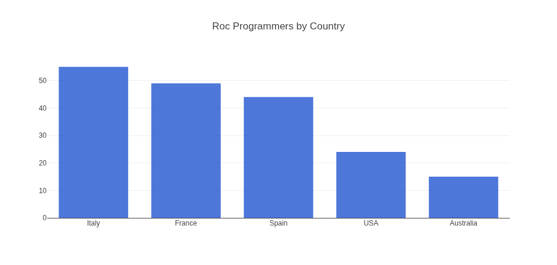
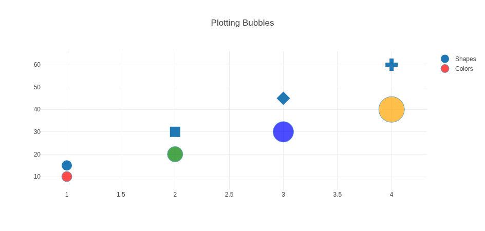
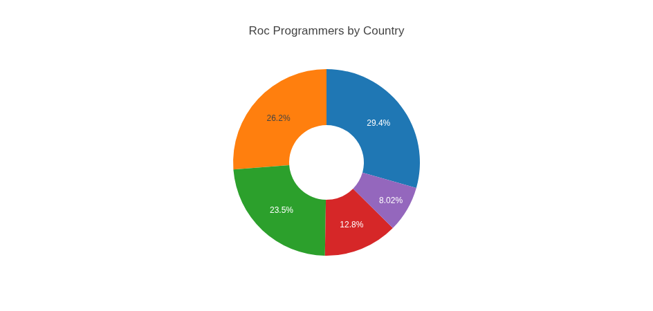
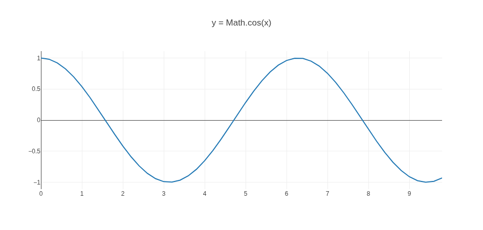
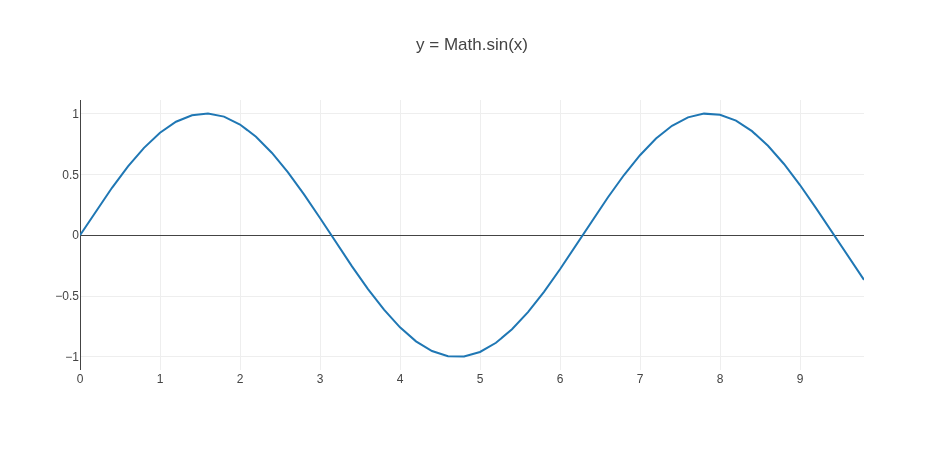
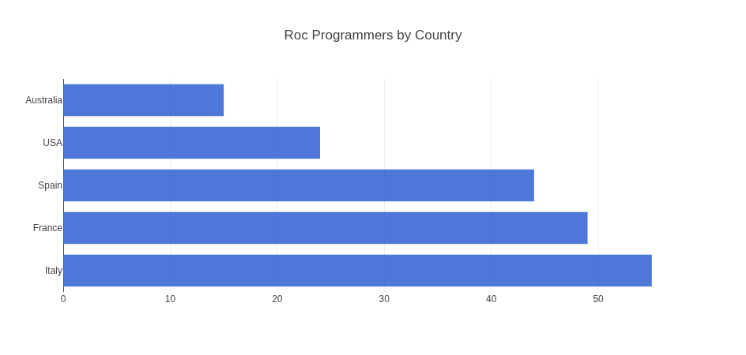
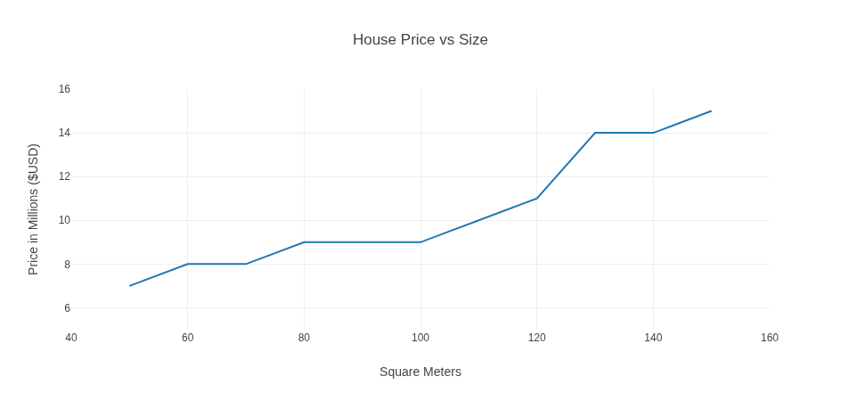
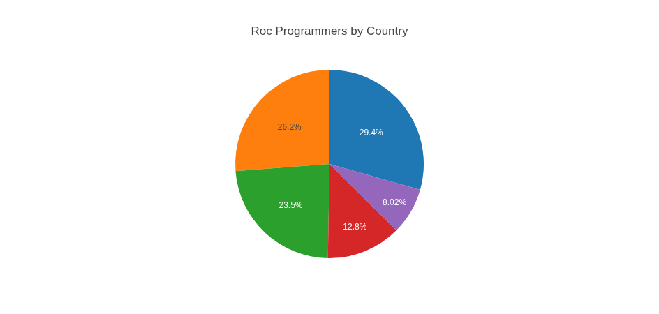
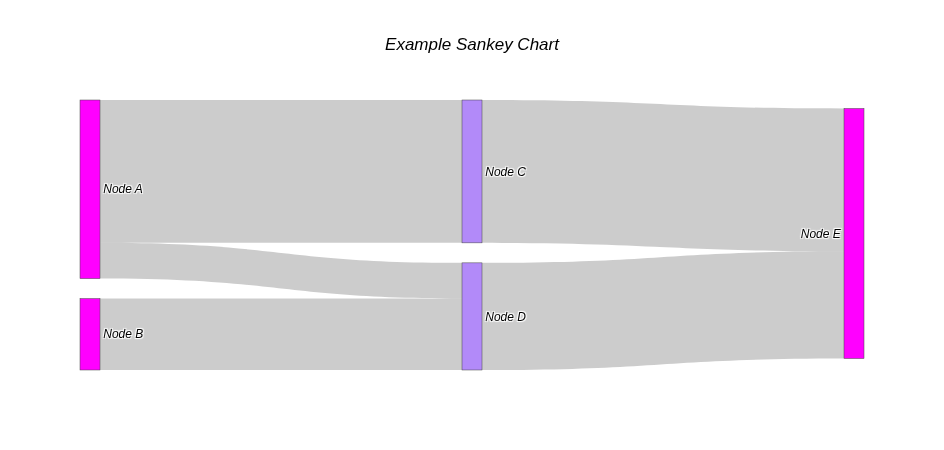
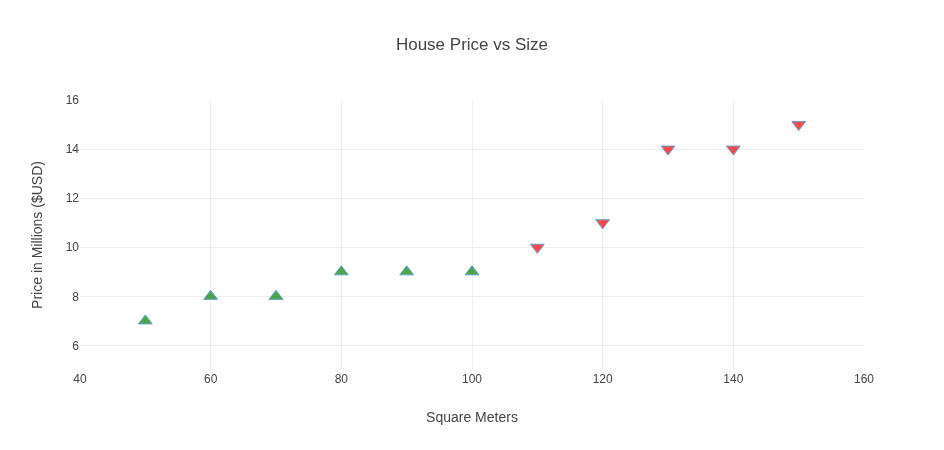

# Plume

A pure [Roc](https://www.roc-lang.org) package for building interactive charts with [Plotly.js](https://github.com/plotly/plotly.js). Create typed traces and layouts, then render JSON or a complete HTML document.

Build bar charts, scatter plots, lines, bubbles, pies, donuts and Sankey diagrams using validated constructors and props records.

## Try an example

Use the current Roc new compiler nightly. From this checkout:

```sh
roc examples/simple.roc > chart.html
roc examples/bar-chart.roc > bars.html
roc examples/budget.roc examples/baseline.json > budget.html
```

Open the resulting HTML in your browser. Examples print HTML to standard output and never launch a browser. The HTML loads the pinned Plotly.js script from its CDN, so displaying a chart requires network access.

Each release's examples archive contains runnable examples bound to that exact package release. Repository examples use the package in this checkout.

## Build a chart

This example uses the same relative import as files under `examples/`. For an application outside this checkout, use the content-addressed package URL from the release instead.

```roc
app [main!] {
    cli: platform "https://github.com/roc-lang/basic-cli/releases/download/0.26.0/GddgvsGjiNXrHFW6au5i5dUDbTs8FinQdrgE2Gqmw53t.tar.zst",
    plume: "../package/main.roc",
}

import cli.OsStr
import cli.Stdout
import plume.Bar
import plume.Chart
import plume.Layout
import plume.Title

main! : List(OsStr) => Try({}, _)
main! = |_args| {
    sales = Bar.new({
        data: [
            { x: "Apples", y: 12.F64 },
            { x: "Oranges", y: 8 },
        ],
        name: "Sales",
    })?
    chart = Chart.new({
        traces: [Bar(sales)],
        layout: Layout.new({ title: Title.new({ text: "Fruit Sales" }) }),
    })
    Stdout.line!(chart.to_html())?
    Ok({})
}
```

Configure a constructor with a record containing only the fields you need. Mix trace types in `Chart.new({ traces: [...] })`; each trace owns its coordinate types. Use `chart.to_json()` when embedding the Plotly figure in another application, or `chart.to_html()` for a standalone document.

Marker symbols, scatter modes and orientations are closed tags: `Diamond`, `LinesMarkers` and `Horizontal`, for example. Colors use named channels: `Color.rgb({ red: 124, green: 56, blue: 245 })`. Fallible constructors return `Try` and compose with `?`; invalid data never waits until rendering to report an error. Sankey nodes have stable string IDs distinct from their displayed labels.

JSON output escapes user text, and HTML rendering additionally protects the document title and embedded JSON data. Plotly interprets supported formatting within chart labels and hover text.

## Develop and validate

The repository follows the [Roc style guide](https://gist.github.com/lukewilliamboswell/241a4e8adb7c89c7e0e02f1d303a8fa1) and [roc-automation's pure package guidance](https://lukewilliamboswell.github.io/roc-automation/pure-package.html). The package has no runtime platform dependency; basic-cli is used only by applications and tests.

```sh
blueprint check
blueprint run check
blueprint run docs
```

`check` formats all Roc sources, runs package and application tests, and builds and executes every recorded example. For focused work, `roc test package/main.roc` runs package tests and `roc tests/consumer/main.roc` checks independently decoded JSON and hostile HTML input through the public API.

Example cases live in `tests/spec.json` and record exact stdout, stderr and exit status, including invalid budget input. Review intentional output changes with:

```sh
blueprint run release-test -- test-examples --update
```

Release preparation builds a content-addressed bundle and immutable examples archive, then tests that archive against the candidate bundle with an empty package cache:

```sh
blueprint run release-package -- build 0.0.1-dryrun
blueprint run release-test -- test-archive
```

See the manual under `docs/` for release and automation details. A dry run publishes nothing.

## Examples

### Bar

[Source Code](examples/bar-chart.roc)



### Bubble

[Source Code](examples/bubble.roc)



### Donut

[Source Code](examples/donut.roc)



### Equation Cosine

[Source Code](examples/equation-cosine.roc)



### Equation Sine

[Source Code](examples/equation-sine.roc)



### Horizontal Bar

[Source Code](examples/horizontal-bar-chart.roc)



### Line

[Source Code](examples/line.roc)



### Pie

[Source Code](examples/pie.roc)



### Sankey

[Source Code](examples/sankey.roc)



### Scatter

[Source Code](examples/scatter.roc)


