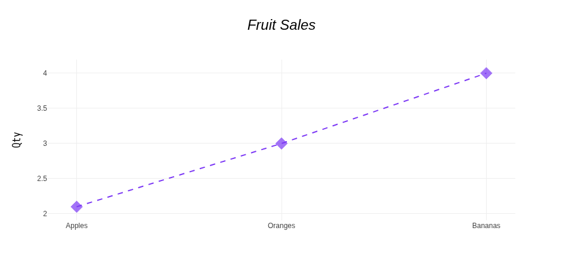
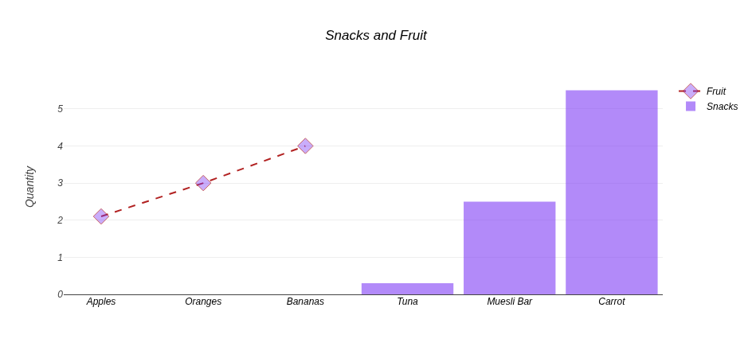
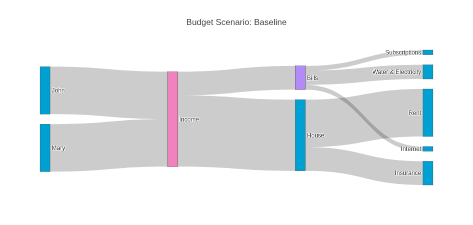

# Plume

A pure [Roc](https://www.roc-lang.org) package for building interactive charts with [Plotly.js](https://github.com/plotly/plotly.js). Create typed traces and layouts, then render JSON or a complete HTML document.

[Documentation](https://lukewilliamboswell.github.io/plume/) · [Latest release](https://github.com/lukewilliamboswell/plume/releases/latest)

## Gallery

Select a chart to open its runnable source.

| | | |
| :---: | :---: | :---: |
| [](examples/bar-chart.roc)<br>**Bars** | [](examples/horizontal-bar-chart.roc)<br>**Horizontal bars** | [](examples/scatter.roc)<br>**Scatter** |
| [](examples/line.roc)<br>**Lines** | [](examples/bubble.roc)<br>**Bubbles** | [](examples/simple.roc)<br>**Styled scatter** |
| [](examples/pie.roc)<br>**Pie** | [](examples/donut.roc)<br>**Donut** | [](examples/hello.roc)<br>**Mixed traces** |
| [](examples/equation-sine.roc)<br>**Sine** | [](examples/equation-cosine.roc)<br>**Cosine** | [](examples/sankey.roc)<br>**Sankey** |
| [](examples/budget.roc)<br>**Budget flows** | | |

## Try an example

Use the current Roc nightly. From this checkout:

```sh
roc examples/simple.roc > chart.html
```

Open `chart.html` in your browser. The generated HTML loads Plotly from its CDN, so viewing the chart requires network access. Examples print HTML to standard output and never launch a browser.

Release examples are bound to their package release; checkout examples use the local package. See the [manual](https://lukewilliamboswell.github.io/plume/) for installation, chart construction, API guarantees and contributor setup.


See [Contributing](CONTRIBUTING.md) to change the package or its gallery.
